# YouTube Discovery — Phase 1: Canonical Entity-Relationship Diagram (ERD) (v1.4)

**Document:** `docs/data-architecture/erd.md`  
**Version:** 1.4 (Final Architecture Correction & Local Implementation Baseline)  
**Baseline Date:** 2 November 2026  
**Status:** **v1.4 CANONICAL ARCHITECTURE SPECIFICATION**  
**Execution Mode:** AUTHORIZED LOCAL IMPLEMENTATION ACTIVE  
**Migration Boundary:** MIGRATION FILES GENERATED ONLY — NEVER APPLIED OR DEPLOYED

---

## 1. Architectural Strategy & Entity Inventory (v1.4)

This specification (v1.4) finalizes the relational architecture across six foundational pillars:

1. **Administrator as Primary Owner Today:** The application operates currently as a single-administrator platform. Every piece of application data created by this administrator is explicitly bound to `owner_id = <admin_profile_id>`. There is no global unowned data, shared libraries, or ambient ownership.
2. **Strict Multi-User Isolation for the Future:** When ordinary users are introduced in a future phase, User A cannot read, modify, delete, download, or export User B's data. Enforced at Database (RLS), Application Service, and Object Storage boundaries.
3. **Decoupled Identity, Role, and Ownership:**
   - **Identity:** `auth.users.id` (Supabase Auth cryptographically verified JWT).
   - **Role:** `user_profiles.role` (`'admin'` | `'user'`) for platform operation and diagnostics. Administrative privilege is NOT shared data ownership.
   - **Ownership:** `owner_id` (pointing to `user_profiles.id`) for all business records.
   - **Storage Namespace:** `storage_owner_uuid` (immutable UUID in `user_profiles`) permanently anchors physical storage paths (`<storage_owner_uuid>/persistence/...`), surviving authentication detachment.
4. **Complete Owner-Safe Composite Foreign Keys:**
   - Direct `owner_id` on all 13 leaf/child tables eliminates recursive joins in RLS.
   - Full generational chain: `user_profiles(id) -> storage_datasets(owner_id, id) -> storage_generations(owner_id, dataset_id, id) -> storage_manifest_parts(owner_id, dataset_id, generation_id, id)`.
   - Linear parent generation self-FK: `FOREIGN KEY (owner_id, dataset_id, parent_generation_id) REFERENCES storage_generations(owner_id, dataset_id, id)` with unique index preventing branching.
   - Direct link between Sync Batch and Generation: `storage_generations.source_batch_id` references `save_sync_batches(owner_id, dataset_id, id)`.
   - Column-specific composite nullification: `ON DELETE SET NULL (generation_id, manifest_part_id)` preserves live index rows and owner IDs when historical generations are pruned.
   - Playlist group nullification: `ON DELETE SET NULL (group_id)` preserves `playlist_id`.
5. **PostgreSQL as Sole Authoritative Truth for Current Generation:** `storage_datasets.current_generation_id` is the single source of truth. The root `manifest.json` in object storage is purely a derived convenience artifact.
6. **Direct Permanent Upload Protocol:** Manifest parts are uploaded directly to immutable permanent generation paths. An uncommitted generation is invisible to reads until Stage 4 atomic commit in PostgreSQL. Abandoned uncommitted uploads are cleaned up without any rename/move operation.

---

### 1.1 Canonical Entity Inventory (Exactly 18 Tables)

```text
Identity, Roles & User Preferences Domain (2 Tables):
├── user_profiles                  (Profile record anchored to auth.users.id via ON DELETE SET NULL)
└── user_preferences              (1:1 user settings, theme, preferred timezone)

Storage Registry & Manifest Explorer Domain (4 Tables):
├── storage_datasets               (Authoritative dataset registry per owner; singleton + entity-scoped)
├── storage_generations            (Committed immutable generation snapshots; linear parent lineage)
├── storage_manifest_parts         (Individual chunks <= 45 MiB with SHA-256; direct permanent paths)
└── storage_temp_objects           (Managed temporary objects: export ZIPs, query caches with hard TTL)

User Workspaces & Domain Indexes (8 Tables):
├── saved_items_index              (Relational search/filter index with daily calendar grouping)
├── user_playlists                 (Personal playlists; exact 1:1 relationship with storage dataset)
├── user_playlist_groups           (Sections/groups inside personal playlists)
├── user_playlist_entries          (Ordered playlist memberships: YouTube or custom)
├── research_queue_items           ("Items I Will Search For" saved from cards)
├── saved_references               (Manually saved titles, articles, external URLs)
├── saved_search_presets           (Reusable query presets with filters/pinning; relational-only)
└── search_history_records         (Permanent audit of executed searches + exact generation links)

Operational, Quota & Audit Domain (4 Tables):
├── managed_api_keys               (AES-256-GCM encrypted YouTube API v3 keys; soft-delete enabled)
├── quota_usage_events             (Idempotent quota accounting, Pacific timezone, request fingerprint)
├── save_sync_batches              (Option A: Single dataset sync batch with expected_revision & fingerprint)
└── audit_logs                     (Security and administrative log; actor vs subject separation)
```

> **Note on Sync Batches:** Option A enforces single-dataset batching. There is NO `save_sync_batch_items` entity.

---

## 2. Canonical Mermaid ERD (v1.4)

```mermaid
erDiagram
    %% Identity, Profiles & Preferences
    USER_PROFILES ||--o| USER_PREFERENCES : configures
    USER_PROFILES ||--o{ MANAGED_API_KEYS : owns
    USER_PROFILES ||--o{ STORAGE_DATASETS : owns
    USER_PROFILES ||--o{ STORAGE_GENERATIONS : owns
    USER_PROFILES ||--o{ STORAGE_MANIFEST_PARTS : owns
    USER_PROFILES ||--o{ STORAGE_TEMP_OBJECTS : stages
    USER_PROFILES ||--o{ SAVED_ITEMS_INDEX : saves
    USER_PROFILES ||--o{ USER_PLAYLISTS : creates
    USER_PROFILES ||--o{ USER_PLAYLIST_GROUPS : owns
    USER_PROFILES ||--o{ USER_PLAYLIST_ENTRIES : owns
    USER_PROFILES ||--o{ RESEARCH_QUEUE_ITEMS : queues
    USER_PROFILES ||--o{ SAVED_REFERENCES : bookmarks
    USER_PROFILES ||--o{ SAVED_SEARCH_PRESETS : creates
    USER_PROFILES ||--o{ SEARCH_HISTORY_RECORDS : executes
    USER_PROFILES ||--o{ QUOTA_USAGE_EVENTS : incurs
    USER_PROFILES ||--o{ SAVE_SYNC_BATCHES : synchronizes
    USER_PROFILES ||--o{ AUDIT_LOGS : "acts as actor"
    USER_PROFILES ||--o{ AUDIT_LOGS : "subject of action"

    %% Storage Registry & Generational Chain (Dual-Layer)
    STORAGE_DATASETS ||--o{ STORAGE_GENERATIONS : "advances revisions"
    STORAGE_GENERATIONS ||--o{ STORAGE_GENERATIONS : "linear parent lineage"
    STORAGE_GENERATIONS ||--o{ STORAGE_MANIFEST_PARTS : "split into parts"
    SAVE_SYNC_BATCHES ||--|| STORAGE_GENERATIONS : "originates 1:1 generation"
    STORAGE_DATASETS ||--o{ SAVE_SYNC_BATCHES : "synchronized via Option A"

    %% Personal Playlists (Composite Ownership & Integrity)
    USER_PLAYLISTS ||--o{ USER_PLAYLIST_GROUPS : organizes
    USER_PLAYLISTS ||--o{ USER_PLAYLIST_ENTRIES : contains
    USER_PLAYLIST_GROUPS ||--o{ USER_PLAYLIST_ENTRIES : "groups entries"

    %% API Keys & Quota (Owner-Enforced Attribution)
    MANAGED_API_KEYS ||--o{ QUOTA_USAGE_EVENTS : "attributed to"

    %% Domain Linkages to Storage Registry & Generations
    STORAGE_MANIFEST_PARTS ||--o{ SAVED_ITEMS_INDEX : "provenance link"
    STORAGE_DATASETS ||--|| USER_PLAYLISTS : "exact 1:1 dataset"
    STORAGE_MANIFEST_PARTS ||--o{ RESEARCH_QUEUE_ITEMS : "provenance link"
    STORAGE_MANIFEST_PARTS ||--o{ SAVED_REFERENCES : "provenance link"
    
    STORAGE_DATASETS ||--o{ SEARCH_HISTORY_RECORDS : "history dataset"
    STORAGE_GENERATIONS ||--o{ SEARCH_HISTORY_RECORDS : "immutable search result snapshot"

    USER_PROFILES {
        uuid id PK
        uuid auth_user_id UK "Nullable FK auth.users(id) ON DELETE SET NULL"
        varchar role "admin | user"
        varchar username "Explicitly provisioned"
        varchar email_snapshot "Display only; never authorization key"
        uuid storage_owner_uuid UK "Permanent storage identifier"
        varchar storage_namespace "Explicitly provisioned"
        boolean is_suspended "Administrative lock"
        timestamptz suspended_at
        boolean is_deleted "Soft-delete preserving audit history"
        timestamptz deleted_at
        timestamptz last_seen_at
        timestamptz created_at
        timestamptz updated_at
    }

    USER_PREFERENCES {
        uuid id PK
        uuid owner_id UK "FK user_profiles(id) ON DELETE CASCADE"
        varchar preferred_timezone "e.g. America/Los_Angeles"
        varchar theme "dark | light | system"
        integer default_page_size
        integer default_max_pages
        integer default_max_items
        boolean auto_save_enabled
        integer auto_save_interval_hours
        jsonb custom_settings
        timestamptz updated_at
    }

    STORAGE_DATASETS {
        uuid id PK
        uuid owner_id FK "FK user_profiles(id) ON DELETE RESTRICT"
        varchar dataset_type "SAVED_ITEMS | PLAYLIST | SEARCH_HISTORY | RESEARCH_QUEUE | SAVED_REFERENCES"
        varchar entity_id "Nullable logical entity ID"
        varchar storage_prefix "<storage-owner-uuid>/persistence/..."
        uuid current_generation_id "FK storage_generations(id) ON DELETE RESTRICT"
        bigint current_revision "Starts at 0; advances to 1 on first commit"
        integer schema_version
        timestamptz created_at
        timestamptz updated_at
    }

    STORAGE_GENERATIONS {
        uuid id PK
        uuid owner_id FK "FK user_profiles(id) ON DELETE RESTRICT"
        uuid dataset_id FK "Composite FK storage_datasets(owner_id, id)"
        uuid source_batch_id UK "Composite FK save_sync_batches(owner_id, dataset_id, id)"
        uuid parent_generation_id "Nullable Composite Self-FK (owner_id, dataset_id, parent_generation_id)"
        varchar state "PREPARING | UPLOADING | VERIFYING | COMMITTED | FAILED | ABANDONED"
        varchar idempotency_key "Scoped to dataset_id"
        integer item_count
        integer part_count
        bigint total_bytes
        varchar sha256_checksum "Canonical aggregate SHA-256"
        integer schema_version
        timestamptz committed_at
        timestamptz created_at
    }

    STORAGE_MANIFEST_PARTS {
        uuid id PK
        uuid owner_id FK "FK user_profiles(id) ON DELETE RESTRICT"
        uuid dataset_id FK "FK storage_datasets(id)"
        uuid generation_id FK "Composite FK storage_generations(owner_id, dataset_id, id)"
        integer part_number "1-based sequence index"
        varchar storage_path UK "Direct permanent path: .../parts/part-000001.json"
        integer record_count
        bigint byte_count "<= 47185920 (45 MiB hard ceiling)"
        varchar sha256_checksum "Hexadecimal 64-char hash"
        timestamptz created_at
    }

    STORAGE_TEMP_OBJECTS {
        uuid id PK
        uuid owner_id FK "FK user_profiles(id) ON DELETE CASCADE"
        varchar storage_path UK "Path under <storage-owner-uuid>/temp/..."
        varchar temp_type "EXPORT_ARTIFACT | TEMP_SEARCH | ABANDONED_GENERATION"
        bigint byte_size
        varchar status "ACTIVE | EXPIRED | DELETING | DELETED | FAILED"
        timestamptz expires_at "Hard cleanup deadline"
        timestamptz created_at
    }

    SAVED_ITEMS_INDEX {
        uuid id PK
        uuid owner_id FK "FK user_profiles(id) ON DELETE CASCADE"
        uuid dataset_id FK "Nullable FK storage_datasets(id)"
        uuid generation_id FK "Nullable FK storage_generations(id)"
        uuid manifest_part_id FK "Nullable Composite FK storage_manifest_parts ON DELETE SET NULL"
        integer item_position "Position inside manifest part items[] (>= 0)"
        varchar entity_type "video | channel | playlist"
        varchar platform_item_id "Canonical YouTube ID"
        varchar title
        varchar channel_title
        varchar thumbnail_url
        boolean is_shorts_like "Presentation classification"
        boolean is_age_restricted
        timestamptz published_at
        bigint views_count "Nullable; 0 is distinct from NULL"
        bigint likes_count "Nullable; 0 is distinct from NULL"
        bigint comments_count "Nullable; 0 is distinct from NULL"
        integer duration_seconds
        timestamptz saved_at "Authoritative save instant (UTC)"
        date saved_date "Cached calendar date via preferred_timezone"
        timestamptz created_at
        timestamptz updated_at
    }

    USER_PLAYLISTS {
        uuid id PK
        uuid owner_id FK "FK user_profiles(id) ON DELETE CASCADE"
        uuid dataset_id UK "1:1 FK storage_datasets(id) ON DELETE RESTRICT"
        varchar name
        text description
        integer display_order
        integer cached_item_count
        integer cached_group_count
        jsonb cached_thumbnails "Array of up to 4 thumbnail URLs"
        timestamptz created_at
        timestamptz updated_at
    }

    USER_PLAYLIST_GROUPS {
        uuid id PK
        uuid owner_id FK "FK user_profiles(id) ON DELETE CASCADE"
        uuid playlist_id FK "Composite FK user_playlists(owner_id, id)"
        varchar title
        text description
        integer position "Manual display order"
        timestamptz created_at
        timestamptz updated_at
    }

    USER_PLAYLIST_ENTRIES {
        uuid id PK
        uuid owner_id FK "FK user_profiles(id) ON DELETE CASCADE"
        uuid playlist_id FK "Composite FK user_playlists(owner_id, id)"
        uuid group_id FK "Nullable Composite FK user_playlist_groups(playlist_id, id) ON DELETE SET NULL (group_id)"
        varchar entry_kind "youtube | custom"
        varchar youtube_resource_type "video | channel | playlist (Nullable for custom)"
        boolean is_shorts_like "Presentation classification"
        varchar platform_item_id "Canonical ID (Nullable for custom)"
        varchar custom_title "Required for custom items"
        varchar url
        text note
        integer position "Manual display order"
        timestamptz added_at
        timestamptz updated_at
    }

    RESEARCH_QUEUE_ITEMS {
        uuid id PK
        uuid owner_id FK "FK user_profiles(id) ON DELETE CASCADE"
        uuid dataset_id FK "Nullable FK storage_datasets(id)"
        uuid generation_id FK "Nullable FK storage_generations(id)"
        uuid manifest_part_id FK "Nullable Composite FK storage_manifest_parts ON DELETE SET NULL"
        integer item_position
        varchar item_type "video | channel | playlist"
        varchar platform_item_id
        varchar title
        varchar url
        varchar channel_title
        varchar thumbnail_url
        boolean is_shorts_like
        varchar source_query
        varchar source_type "SEARCH | AI_SEARCH | LINK_EXPLORER | MANUAL"
        varchar status "PENDING | REVIEWED | DISMISSED"
        integer priority
        text notes
        timestamptz queued_at
        timestamptz created_at
        timestamptz updated_at
    }

    SAVED_REFERENCES {
        uuid id PK
        uuid owner_id FK "FK user_profiles(id) ON DELETE CASCADE"
        uuid dataset_id FK "Nullable FK storage_datasets(id)"
        uuid generation_id FK "Nullable FK storage_generations(id)"
        uuid manifest_part_id FK "Nullable Composite FK storage_manifest_parts ON DELETE SET NULL"
        integer item_position
        varchar title
        text url "Arbitrary validated web URL"
        text description
        text notes
        text[] tags
        varchar category
        timestamptz created_at
        timestamptz updated_at
    }

    SAVED_SEARCH_PRESETS {
        uuid id PK
        uuid owner_id FK "FK user_profiles(id) ON DELETE CASCADE"
        varchar title
        varchar query
        varchar resource_selection "ALL | video | channel | playlist"
        jsonb settings_snapshot
        boolean is_pinned
        text notes
        timestamptz created_at
        timestamptz updated_at
    }

    SEARCH_HISTORY_RECORDS {
        uuid id PK
        uuid owner_id FK "FK user_profiles(id) ON DELETE CASCADE"
        uuid dataset_id FK "FK storage_datasets(id)"
        uuid generation_id FK "Composite FK storage_generations(owner_id, dataset_id, id) ON DELETE RESTRICT"
        varchar title
        varchar query
        varchar resource_selection
        jsonb settings_snapshot
        integer results_count
        integer video_count
        integer channel_count
        integer playlist_count
        integer quota_cost_estimate
        varchar status "complete | failed | partial | empty"
        text[] top_thumbnails
        timestamptz executed_at
    }

    MANAGED_API_KEYS {
        uuid id PK
        uuid owner_id FK "FK user_profiles(id) ON DELETE RESTRICT"
        varchar label
        varchar masked_preview "...3a8f"
        text encrypted_bundle "Versioned JSON envelope (AES-256-GCM + IV + tag + AAD)"
        varchar project_id
        varchar project_confidence "declared | verified | unknown"
        boolean is_enabled
        integer priority_order
        boolean is_archived "Soft-delete flag"
        timestamptz archived_at
        timestamptz last_used_at
        timestamptz quota_exhausted_at
        timestamptz cooldown_until
        varchar last_error
        timestamptz created_at
        timestamptz updated_at
    }

    QUOTA_USAGE_EVENTS {
        uuid id PK
        uuid owner_id FK "FK user_profiles(id) ON DELETE RESTRICT"
        uuid managed_api_key_id FK "Composite FK managed_api_keys(owner_id, id) ON DELETE SET NULL (managed_api_key_id)"
        varchar idempotency_key "Scoped to owner_id"
        varchar request_sha256 "Payload fingerprint"
        varchar project_id "Historical snapshot"
        varchar quota_bucket "search | other"
        integer units_consumed
        varchar endpoint_called
        varchar status "SUCCESS | QUOTA_EXCEEDED | INVALID_KEY | ERROR"
        date pacific_date "Derived America/Los_Angeles anchor"
        timestamptz executed_at
    }

    SAVE_SYNC_BATCHES {
        uuid id PK
        uuid owner_id FK "FK user_profiles(id) ON DELETE RESTRICT"
        uuid dataset_id FK "Composite FK storage_datasets(owner_id, id) ON DELETE RESTRICT"
        varchar idempotency_key "Scoped to (owner_id, dataset_id)"
        varchar request_sha256 "Payload items fingerprint"
        bigint expected_revision "Optimistic concurrency guard"
        bigint client_sequence "Local sequence from IndexedDB"
        bigint committed_revision "Assigned server revision on success"
        varchar state "PENDING | PREPARING | UPLOADING | VERIFYING | COMMITTED | FAILED | CONFLICT"
        integer operations_count
        timestamptz completed_at
        timestamptz created_at
    }

    AUDIT_LOGS {
        uuid id PK
        uuid actor_profile_id FK "FK user_profiles(id) ON DELETE RESTRICT"
        uuid subject_owner_id FK "Nullable FK user_profiles(id) ON DELETE RESTRICT"
        varchar action_type
        varchar entity_type
        varchar entity_id
        jsonb details
        varchar ip_address
        varchar user_agent
        timestamptz created_at
    }
```



---

## 3. Strict Composite Foreign Key Specifications

### 3.1 Generational Storage Hierarchy

```sql
-- 1. storage_datasets composite uniqueness
ALTER TABLE storage_datasets
  ADD CONSTRAINT uq_storage_datasets_owner_id UNIQUE (owner_id, id);

-- 2. storage_generations composite FK to dataset
ALTER TABLE storage_generations
  ADD CONSTRAINT fk_storage_generations_dataset
  FOREIGN KEY (owner_id, dataset_id)
  REFERENCES storage_datasets(owner_id, id)
  ON DELETE CASCADE;

-- 3. storage_generations composite unique key
ALTER TABLE storage_generations
  ADD CONSTRAINT uq_storage_generations_owner_dataset_id UNIQUE (owner_id, dataset_id, id);

-- 4. storage_generations composite FK to originating sync batch
ALTER TABLE storage_generations
  ADD CONSTRAINT fk_storage_generations_source_batch
  FOREIGN KEY (owner_id, dataset_id, source_batch_id)
  REFERENCES save_sync_batches(owner_id, dataset_id, id)
  ON DELETE RESTRICT;

-- 5. storage_generations linear parent lineage self-FK
ALTER TABLE storage_generations
  ADD CONSTRAINT fk_storage_generations_parent
  FOREIGN KEY (owner_id, dataset_id, parent_generation_id)
  REFERENCES storage_generations(owner_id, dataset_id, id)
  ON DELETE RESTRICT;

-- 6. storage_generations linear lineage constraint (prevents branching among committed generations)
CREATE UNIQUE INDEX uq_storage_generations_linear
ON storage_generations (owner_id, dataset_id, parent_generation_id)
WHERE state = 'COMMITTED';

-- 7. storage_manifest_parts composite FK to generation
ALTER TABLE storage_manifest_parts
  ADD CONSTRAINT fk_storage_manifest_parts_generation
  FOREIGN KEY (owner_id, dataset_id, generation_id)
  REFERENCES storage_generations(owner_id, dataset_id, id)
  ON DELETE CASCADE;

-- 8. storage_manifest_parts composite unique key for domain provenance
ALTER TABLE storage_manifest_parts
  ADD CONSTRAINT uq_storage_manifest_parts_composite UNIQUE (owner_id, dataset_id, generation_id, id);

-- 9. Current generation pointer on storage_datasets
ALTER TABLE storage_datasets
  ADD CONSTRAINT fk_storage_datasets_current_gen
  FOREIGN KEY (owner_id, id, current_generation_id)
  REFERENCES storage_generations(owner_id, dataset_id, id)
  ON DELETE RESTRICT;
```

---

### 3.2 Personal Playlists Hierarchy

```sql
-- 1. user_playlists composite unique key
ALTER TABLE user_playlists
  ADD CONSTRAINT uq_user_playlists_owner_id UNIQUE (owner_id, id);

-- 2. user_playlist_groups composite FK to playlist
ALTER TABLE user_playlist_groups
  ADD CONSTRAINT fk_user_playlist_groups_playlist
  FOREIGN KEY (owner_id, playlist_id)
  REFERENCES user_playlists(owner_id, id)
  ON DELETE CASCADE;

-- 3. user_playlist_groups composite unique key
ALTER TABLE user_playlist_groups
  ADD CONSTRAINT uq_user_playlist_groups_playlist_id UNIQUE (playlist_id, id);

-- 4. user_playlist_entries composite FK to playlist
ALTER TABLE user_playlist_entries
  ADD CONSTRAINT fk_user_playlist_entries_playlist
  FOREIGN KEY (owner_id, playlist_id)
  REFERENCES user_playlists(owner_id, id)
  ON DELETE CASCADE;

-- 5. user_playlist_entries composite FK to group with column-specific nullification
ALTER TABLE user_playlist_entries
  ADD CONSTRAINT fk_user_playlist_entries_group
  FOREIGN KEY (playlist_id, group_id)
  REFERENCES user_playlist_groups(playlist_id, id)
  ON DELETE SET NULL (group_id);
```

---

### 3.3 Domain Provenance Composite Foreign Keys (Column-Specific Nullification)

```sql
-- 1. saved_items_index composite FK to manifest part
ALTER TABLE saved_items_index
  ADD CONSTRAINT fk_saved_items_manifest_part
  FOREIGN KEY (owner_id, dataset_id, generation_id, manifest_part_id)
  REFERENCES storage_manifest_parts(owner_id, dataset_id, generation_id, id)
  ON DELETE SET NULL (generation_id, manifest_part_id);

-- 2. research_queue_items composite FK to manifest part
ALTER TABLE research_queue_items
  ADD CONSTRAINT fk_research_queue_manifest_part
  FOREIGN KEY (owner_id, dataset_id, generation_id, manifest_part_id)
  REFERENCES storage_manifest_parts(owner_id, dataset_id, generation_id, id)
  ON DELETE SET NULL (generation_id, manifest_part_id);

-- 3. saved_references composite FK to manifest part
ALTER TABLE saved_references
  ADD CONSTRAINT fk_saved_references_manifest_part
  FOREIGN KEY (owner_id, dataset_id, generation_id, manifest_part_id)
  REFERENCES storage_manifest_parts(owner_id, dataset_id, generation_id, id)
  ON DELETE SET NULL (generation_id, manifest_part_id);
```

---

## 4. Current Generation Commitment Guard (Database Trigger)

A standard Foreign Key enforces existence, but cannot inspect column values of the referenced row. To guarantee that `storage_datasets.current_generation_id` can ONLY reference a generation that has been verified and committed:

```sql
CREATE OR REPLACE FUNCTION trg_verify_dataset_current_generation()
RETURNS trigger AS $$
DECLARE
  gen_state varchar(20);
BEGIN
  IF NEW.current_generation_id IS NOT NULL THEN
    SELECT state INTO gen_state 
    FROM public.storage_generations
    WHERE id = NEW.current_generation_id 
      AND dataset_id = NEW.id 
      AND owner_id = NEW.owner_id;
      
    IF gen_state IS NULL THEN
      RAISE EXCEPTION 'Referenced current_generation_id does not exist in this dataset.';
    ELSIF gen_state != 'COMMITTED' THEN
      RAISE EXCEPTION 'Cannot set current_generation_id to uncommitted generation (state: %).', gen_state;
    END IF;
  END IF;
  RETURN NEW;
END;
$$ LANGUAGE plpgsql;

CREATE TRIGGER trg_dataset_current_generation_guard
BEFORE INSERT OR UPDATE OF current_generation_id ON public.storage_datasets
FOR EACH ROW EXECUTE FUNCTION trg_verify_dataset_current_generation();
```

---

## 5. Dataset Uniqueness & Cardinality

To prevent duplicate datasets while handling nullable `entity_id`:

```sql
-- 1. Singleton datasets (SAVED_ITEMS, RESEARCH_QUEUE, SAVED_REFERENCES, SEARCH_HISTORY)
-- Exactly ONE per owner per dataset type
CREATE UNIQUE INDEX uq_storage_datasets_singleton
ON public.storage_datasets (owner_id, dataset_type)
WHERE entity_id IS NULL;

-- 2. Entity-scoped datasets (PLAYLIST where entity_id = playlist_id::text)
-- Exactly ONE per entity per owner
CREATE UNIQUE INDEX uq_storage_datasets_entity
ON public.storage_datasets (owner_id, dataset_type, entity_id)
WHERE entity_id IS NOT NULL;
```
