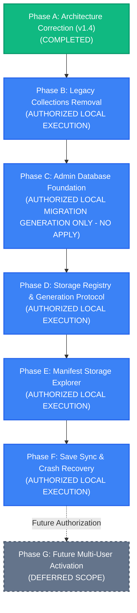

# YouTube Discovery — Canonical Implementation Plan (Phases A–G) (v1.4)

**Document:** `docs/data-architecture/implementation-plan.md`  
**Version:** 1.4 (Final Architecture Correction + Full Local Implementation Execution)  
**Baseline Date:** 2 November 2026  
**Status:** **APPROVED SPECIFICATION & AUTHORIZED LOCAL IMPLEMENTATION ROADMAP**  
**Execution Mode:** LOCAL DEVELOPMENT & MIGRATION FILE GENERATION ONLY (NO DATABASE DEPLOYMENT OR LIVE MIGRATION APPLICATION)  

---

## 1. Executive Implementation Roadmap

The implementation roadmap is partitioned into seven strictly sequenced, dependency-controlled phases.  
The project owner has explicitly authorized execution of Phase A (v1.4 architecture documents) and the local development work of Phases B through F.

---

## 2. Phase-by-Phase Specifications

### Phase A — Architecture Correction & Documentation (v1.4)
- **Status:** **COMPLETED**
- **Objective:** Finalize and verify all v1.4 architectural specifications across all project documentation.
- **Deliverables:**
  - `docs/data-architecture/erd.md` (v1.4)
  - `docs/data-architecture/data-dictionary.md` (v1.4)
  - `docs/data-architecture/manifest-format.md` (v1.4)
  - `docs/data-architecture/sync-and-recovery.md` (v1.4)
  - `docs/security/auth-storage-rls.md` (v1.4)
  - `docs/data-architecture/adr-001-multi-user-storage-explorer.md` (v1.4)
  - `docs/data-architecture/implementation-plan.md` (v1.4)
  - `implementation-guide.md` (v1.4 synchronized)
  - `youtube_discovery_ledger.md` (v1.4 synchronized)
  - `PROJECT_CHANGE_LOG_LEDGER.md` (Phase 1.4 entry appended)
- **Security Requirements:** Zero secrets printed. Zero database mutations.
- **Verification:** Internal cross-document consistency audit, migration CLI test suite.

---

### Phase B — Legacy Collections Removal
- **Status:** **AUTHORIZED LOCAL EXECUTION**
- **Objective:** Safely eliminate obsolete Collections code, components, and types without touching database tables or unrelated replacement features.
- **Prerequisites:** Phase A completed.
- **Deliverables:**
  - Safe deletion of `src/app/collections/` directory.
  - Safe deletion of `src/components/collections/` directory.
  - Clean audit of imports in `src/components/layout/navigation.tsx` and app shell navigation menus.
  - Removal of obsolete `youtube_saved_collection` references in `src/types/` and AI schemas.
  - Verification that Saved Items (`/saved`), Playlist Manager (`/playlist-manager`), and Saved Searches (`/saved-searches`) remain 100% operational.
- **Security Requirements:** No destructive database or storage operations.
- **Verification:** `npm run typecheck`, `npm run lint`, Next.js build verification (`npm run build`).

---

### Phase C — Administrator-Owned Database Foundation
- **Status:** **AUTHORIZED LOCAL MIGRATION GENERATION ONLY**
- **Objective:** Create the canonical Prisma schema with all 18 models and author the migration DDL file establishing the exact 18 canonical tables, composite foreign keys, partial unique indexes, checks, triggers, functions, and RLS policies.
- **CRITICAL RESTRICTION:** Author and generate migration files ONLY. **NEVER APPLY, PUSH, OR EXECUTE MIGRATIONS** against the live database (`prisma migrate deploy` or `prisma db push` are strictly prohibited).
- **Prerequisites:** Phase B completed and verified.
- **Deliverables:**
  - `prisma/schema.prisma` updated with approved 18 canonical models (no `save_sync_batch_items`).
  - Migration SQL file authored under `prisma/migrations/20261102000000_canonical_v1_4_foundation/migration.sql`.
  - Migration DDL including:
    - Auth foreign key on `user_profiles(auth_user_id)` to `auth.users(id) ON DELETE SET NULL`.
    - Column-specific composite FK on playlist entries: `ON DELETE SET NULL (group_id)`.
    - Composite foreign keys on groups, entries, datasets, generations, manifest parts, and quota events.
    - Partial unique indexes: `uq_storage_datasets_singleton`, `uq_storage_datasets_entity`, `uq_storage_generations_linear`, `idx_playlist_youtube_unique`.
    - Database triggers protecting `user_profiles` privileged columns and enforcing `current_generation_id` commitment.
    - Hardened RLS helper functions `current_user_profile_id()` and `current_user_storage_owner_uuid()`.
    - Row-Level Security (RLS) enabled across all 18 tables with user isolation policies.
  - Running `npx prisma validate` and `npx prisma generate` to update Prisma Client types locally.
- **Security Requirements:** All tables enforce `owner_id = current_user_profile_id()`. Service-role access strictly isolated.
- **Verification:** `npm run test:migrations`, Prisma schema validation (`npx prisma validate`).

---

### Phase D — Storage Registry and Direct Generation Protocol
- **Status:** **AUTHORIZED LOCAL EXECUTION**
- **Objective:** Implement the dual-layer Supabase Storage integration with private bucket enforcement, direct immutable generation part uploading scoped by `storage_owner_uuid`, deterministic binary aggregate SHA-256, and cryptographic validation.
- **Prerequisites:** Phase C local foundation created.
- **Deliverables:**
  - Supabase Storage adapter enforcing `<storage_owner_uuid>/persistence/` and `<storage_owner_uuid>/temp/` paths.
  - Direct permanent upload implementation targeting `<storage_owner_uuid>/persistence/datasets/<ds-id>/generations/<gen-id>/parts/`.
  - Deterministic serialization engine measuring exact UTF-8 byte lengths with 40 MiB target / 45 MiB ceiling.
  - Checksum generator producing hex SHA-256 digests and deterministic binary aggregate SHA-256 for generations.
  - Compensating cleanup worker logic for abandoned uncommitted generations older than 24 hours.
- **Security Requirements:** Zero public bucket access. Short-lived signed URLs (<= 300s).
- **Verification:** Unit tests for chunking math, aggregate SHA-256 verification, and path generation.

---

### Phase E — Manifest Storage Explorer Implementation
- **Status:** **AUTHORIZED LOCAL EXECUTION**
- **Objective:** Redesign the `/manifests` page and backend API routes into an interactive, real-time physical storage inspector and reconciliation engine.
- **Prerequisites:** Phase D complete and verified.
- **Deliverables:**
  - Explorer UI displaying visual tree: `Owner -> Dataset Type -> Dataset -> Generation -> Parts -> Physical Files`.
  - Backend API routes: `/api/manifests/tree`, `/api/manifests/reconcile`, `/api/manifests/download`, `/api/manifests/export`.
  - Real-time reconciliation engine classifying objects into the 6 canonical states: `VERIFIED`, `MISSING_FROM_STORAGE`, `UNTRACKED_ORPHAN`, `METADATA_MISMATCH`, `UNCOMMITTED_GENERATION`, `INCOMPLETE_PARTS`.
  - Individual part raw download stream.
  - Complete generation ZIP export with pre-validation of SHA-256 part digests.
- **Security Requirements:** Storage Explorer access restricted strictly to authenticated users viewing their own storage namespace.
- **Verification:** API route tests and UI rendering verification.

---

### Phase F — Save Synchronization & Crash Recovery Saga
- **Status:** **AUTHORIZED LOCAL EXECUTION**
- **Objective:** Complete the end-to-end synchronization pipeline implementing Option A single-dataset batches, Stage 4 commit ordering, and IndexedDB crash recovery.
- **Prerequisites:** Phase E complete.
- **Deliverables:**
  - IndexedDB local-first database (`youtube_discovery_local_v1`) with write-ahead outbox journal.
  - Client Save Coordinator executing the 6-stage Storage Commit Saga.
  - Stage 4 Commit Ordering implementation (generation `state = 'COMMITTED'` before dataset pointer update).
  - Request fingerprinting via `request_sha256`.
  - Save Center global UI component with live status badges (`Saved Locally`, `Syncing`, `Cloud Synced`, `Sync Failed`, `Conflict`).
  - Automatic background save trigger (12-hour interval) operating during active browser sessions.
  - Disaster recovery offline export tool.
- **Security Requirements:** Sensitive API credentials never enter IndexedDB.
- **Verification:** Unit tests, lint, typecheck, build.

---

### Phase G — Future Multi-User Activation (Deferred Scope)
- **Status:** **PLANNED / DEFERRED**
- **Prerequisites:** Explicit future authorization by project owner.
- **Scope:**
  - Self-service account registration.
  - Automatic tenant namespace provisioning.
  - Stripe/subscription tier gating.
  - Multi-user administrative moderation tools.
- **Safety Gate:** Must NOT be executed during Phase 1.4. Application remains administrator-only.
