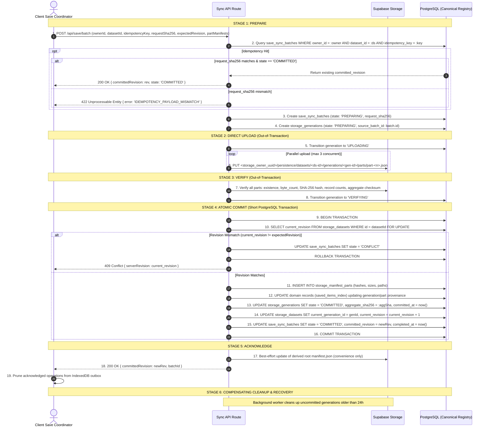

# YouTube Discovery — Phase 1: Local Durability, Synchronization & Recovery Specification (v1.4)

**Document:** `docs/data-architecture/sync-and-recovery.md`  
**Version:** 1.4 (Final Architecture Correction + Full Local Implementation Execution)  
**Baseline Date:** 2 November 2026  
**Status:** **APPROVED ARCHITECTURE SPECIFICATION & IMPLEMENTATION FOUNDATION**  
**Execution Mode:** AUTHORIZED LOCAL IMPLEMENTATION & RUNTIME FOUNDATION  

---

## 1. Local-First Durability & Crash Recovery

User research data is protected by strict local durability:

1. **IndexedDB is Authoritative for Pending Local Changes:**
   - Every mutation is committed to IndexedDB with transaction durability `strict` before the UI indicates `Saved Locally`.
   - Never rely on `window.onbeforeunload` or `window.onunload` to flush data.
2. **Atomic Write-Ahead Outbox Journal:**
   - In a single IndexedDB transaction:
     1. Mutate the domain store entity (e.g. `entities_saved_items`).
     2. Append a pending mutation record to `pending_operations`.
3. **Multi-User Local Partitioning:**
   - All local stores include `ownerId` to ensure local outbox isolation across multi-profile workflows.
4. **Collections Removal:**
   - The legacy `entities_collections` store has been completely removed.

---

## 2. IndexedDB Local Database Schema (`youtube_discovery_local_v1`)

```text
IndexedDB: youtube_discovery_local_v1
├── entities_saved_items        (Key: [ownerId, platformItemId], Index: savedDate, entityType)
├── entities_user_playlists     (Key: id, Index: [ownerId, displayOrder])
├── entities_playlist_groups    (Key: id, Index: [playlistId, position])
├── entities_playlist_entries   (Key: id, Index: [playlistId, position], [playlistId, groupId])
├── entities_research_queue     (Key: id, Index: [ownerId, status, queuedAt])
├── entities_saved_references   (Key: id, Index: [ownerId, createdAt])
├── entities_saved_searches     (Key: id, Index: [ownerId, isPinned, title])
├── entities_search_history     (Key: id, Index: [ownerId, executedAt])
├── workspace_snapshots         (Key: [ownerId, route], value: active filters/query/state)
├── pending_operations          (Key: operationId, Index: [ownerId, datasetId, sequenceNumber], status)
├── local_sync_metadata         (Key: [ownerId, datasetId], value: currentLocalSequence, lastCloudRevision)
└── local_research_reminders    (Key: id, Index: ownerId, [ownerId, videoId], [ownerId, status], [ownerId, addedAt])
                                [100% Client-Local, Excluded from Outbox & Cloud Sync]
```

---

## 3. Storage Upload & PostgreSQL Atomic Commit Saga (Stages 1–6)

### Crucial Architectural Boundary
**A PostgreSQL database transaction CANNOT wrap or coordinate an external HTTP upload to Supabase Storage.**  
Storage upload and PostgreSQL transactions are decoupled across an explicit 6-stage crash-resilient saga using direct immutable uploads to permanent paths scoped by `storage_owner_uuid`.

### 3.1 Detailed Protocol Stages



### 3.2 Crucial Commit Ordering Rule in Stage 4
Database trigger `trg_dataset_current_generation_guard` verifies that any generation referenced by `storage_datasets.current_generation_id` has `state = 'COMMITTED'`.  
Therefore, in Step 13 and Step 14:
- `storage_generations.state` **MUST be updated to `'COMMITTED'` first**.
- `storage_datasets.current_generation_id` **is updated second**.
Attempting to update `storage_datasets.current_generation_id` before committing the generation will cause a foreign-state trigger violation and abort the transaction.

---

## 4. State Machines & Transitions

### 4.1 Storage Generation State Machine (`storage_generations.state`)

```text
       ┌───────────┐
       │ PREPARING │
       └─────┬─────┘
             │ (Upload starts)
             ▼
       ┌───────────┐
       │ UPLOADING │
       └─────┬─────┘
             │ (All parts uploaded)
             ▼
       ┌───────────┐
       │ VERIFYING │
       └─────┬─────┘
             │ (Stage 4 atomic commit succeeds)
             ▼
       ┌───────────┐
       │ COMMITTED │  ◄── IMMUTABLE TERMINAL STATE
       └───────────┘
```
- **Linear Lineage Guard:** `CREATE UNIQUE INDEX uq_storage_generations_linear ON storage_generations (owner_id, dataset_id, parent_generation_id) WHERE state = 'COMMITTED';` enforces that a dataset cannot diverge into multiple concurrent committed generations from the same parent.
- **Failure Path:** Any error during `PREPARING`, `UPLOADING`, or `VERIFYING` transitions to `FAILED`.
- **Abandonment Path:** Generations left in `PREPARING`, `UPLOADING`, or `FAILED` past 24 hours are transitioned to `ABANDONED` by compensating cleanup.
- **Invariance Rule:** A generation in `COMMITTED` state can NEVER be altered, reverted, or deleted by cleanup workers.

### 4.2 Save Sync Batch State Machine (`save_sync_batches.state`)

```text
       ┌─────────┐
       │ PENDING │
       └────┬────┘
            │
            ▼
       ┌───────────┐
       │ PREPARING │
       └─────┬─────┘
             │
             ▼
       ┌───────────┐
       │ UPLOADING │
       └─────┬─────┘
             │
             ▼
       ┌───────────┐
       │ VERIFYING │
       └─────┬─────┘
             ├──► (Commit succeeds) ────► ┌───────────┐
             │                            │ COMMITTED │  ◄── TERMINAL SUCCESS
             ├──► (Revision mismatch) ──► ┌───────────┐
             │                            │ CONFLICT  │  ◄── TERMINAL CONFLICT
             └──► (Network/Storage error)►┌───────────┐
                                          │  FAILED   │  ◄── RETRYABLE
                                          └───────────┘
```
- **Conflict Handling:** When `state = 'CONFLICT'`, the server returns HTTP 409 with the current server revision. The client initiates a pull-and-reconcile operation in IndexedDB before attempting another commit.
- **Idempotency Fingerprint:** `request_sha256` prevents payload drift attacks or corrupted retries under existing idempotency keys.

### 4.3 Temporary Object Lifecycle (`storage_temp_objects.status`)

```text
       ┌────────┐
       │ ACTIVE │
       └───┬────┘
           │ (expires_at reached)
           ▼
       ┌─────────┐
       │ EXPIRED │
       └───┬─────┘
           │ (Cleanup worker initiates deletion)
           ▼
       ┌──────────┐
       │ DELETING │
       └───┬──────┘
           ├──► (Storage API delete verified) ──► ┌─────────┐
           │                                      │ DELETED │ ◄── TERMINAL
           └──► (Storage API error) ────────────► ┌─────────┐
                                                  │ FAILED  │ ◄── RETRYABLE
                                                  └─────────┘
```

---

## 5. Domain Manifest Roles & Index Decoupling

| Domain | Role of PostgreSQL | Role of Supabase Storage Manifest | Historical Versioning Strategy |
|---|---|---|---|
| **`saved_items_index`** | Live authoritative mutable index (daily calendar grouping, filters, search). | Point-in-time immutable backup and complete payload snapshot. | New generation creates a new snapshot; live index rows update their provenance pointers (`ON DELETE SET NULL`). |
| **`user_playlists`** | Live personal playlist metadata, manual ordering, section/group hierarchy. | Point-in-time snapshot of playlist entries and groups in dedicated dataset (`entity_id = playlist_id::text`). | Each cloud save creates a new immutable generation for that playlist. |
| **`research_queue_items`**| Live queue status (`PENDING`, `REVIEWED`, `DISMISSED`) and priority order. | Historical manifest snapshots. | Provenance links to manifest parts (`ON DELETE SET NULL`). |
| **`saved_references`** | Live manual title/URL bookmarks and personal notes. | Historical manifest snapshots. | Provenance links to manifest parts (`ON DELETE SET NULL`). |
| **`search_history_records`**| Permanent audit record of executed searches. | Exact immutable result manifest snapshot. | Direct link to exact generation (`generation_id`); `ON DELETE RESTRICT` guarantees result snapshot is permanently preserved. |
| **`saved_search_presets`**| Live query preset storage, settings snapshots, and pinning. | None (relational-only storage in PostgreSQL). | Purely relational; no object storage overhead. |

### 5.1 Prevention of Accidental Historical Data Loss & Stale Positions
1. **Column-Specific Set Null:** Composite foreign keys from `saved_items_index`, `research_queue_items`, and `saved_references` to `storage_manifest_parts` use `ON DELETE SET NULL (generation_id, manifest_part_id)` while preserving `owner_id` and `dataset_id`.
2. **All-or-None Consistency Check:** A check constraint ensures that `item_position` is also cleared whenever `manifest_part_id` is nullified:
   ```sql
   CHECK (
     (manifest_part_id IS NULL AND item_position IS NULL AND generation_id IS NULL)
     OR
     (manifest_part_id IS NOT NULL AND item_position IS NOT NULL AND generation_id IS NOT NULL)
   )
   ```
   This guarantees that if an old generation is purged from storage, live user items remain in PostgreSQL without dangling or orphaned provenance references.

---

## 6. 2026 Resilient 12-Hour Sync Scheduler & Cloud Hydration

### 6.1 12-Hour Automated Sync Architecture
- **Interval:** 12 hours (43,200,000 ms) tracked persistently in `localStorage.yt_discovery_sync_meta_v1`.
- **Zero-Op Bypass:** If `pendingOperations.length === 0`, the scheduler advances the 12-hour schedule immediately without calling Cloudflare Workers or Supabase PostgreSQL.
- **Sleep & Tab Throttling Protection:** A regular 60-second ticker interval checks for overdue synchronization even if `setTimeout` was suspended by laptop sleep or browser tab throttling.
- **Immediate Catchup:** `document.visibilityState === "visible"` and `window.addEventListener("online")` instantly catch up overdue synchronizations upon tab focus or network restoration.
- **Concurrency Mutex:** Uses `navigator.locks` with automatic fallback to IndexedDB `sync_leases` (60s TTL), preventing race conditions across multiple open tabs.
- **Exponential Backoff:** If remote sync fails, retries are scheduled at 15s, 30s, 60s (max 5 minutes) without advancing the 12-hour schedule or wiping outbox changes.

### 6.2 IndexedDB v4 Schema Additions
```text
IndexedDB: youtube_discovery_local_v1 (Version 4)
├── local_dataset_catalog (Key: [ownerId, datasetType])
│   └── Tracks: localRevision, remoteRevision, lastHydratedGenerationId, syncStatus
├── sync_journal (Key: syncBatchId)
│   └── Tracks: snapshotWatermark, affectedDatasets, batchStatus (UPLOADING -> COMMITTED / FAILED)
└── sync_leases (Key: leaseName)
    └── Tracks: holderTabId, acquiredAt, expiresAt
```

### 6.3 Automated Storage Reconciliation Endpoint
- **Route:** `GET /api/manifests/reconcile`
- **Functionality:** Compares Supabase PostgreSQL `storage_datasets`, `storage_generations`, and `storage_manifest_parts` against physical objects in Cloudflare R2 bucket `new-youtube-discovery-private`.
- **Reports:** Missing parts, orphan permanent objects, stale `/temp/` objects (>24h), and revision divergence.
