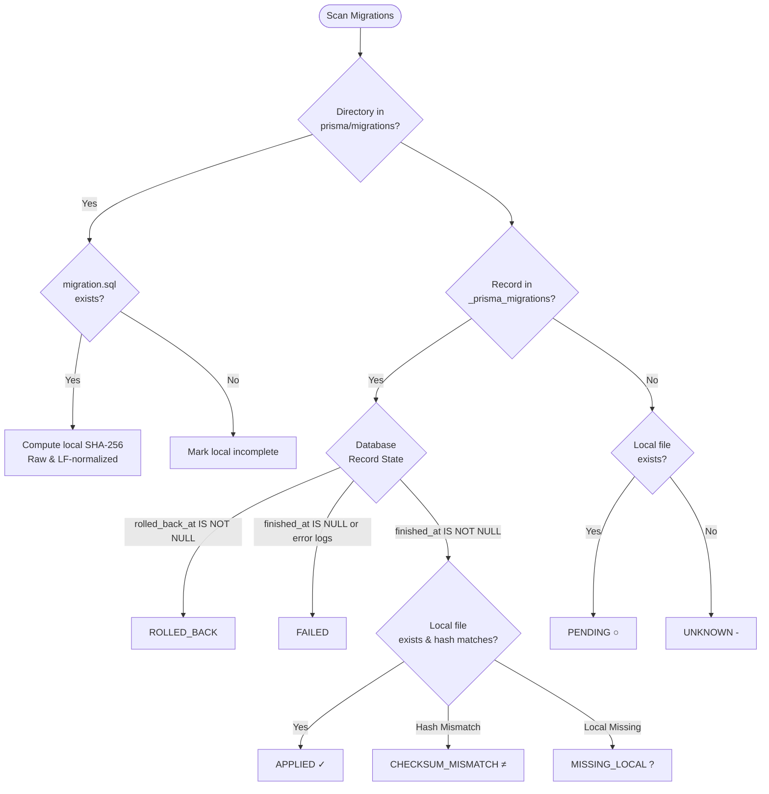
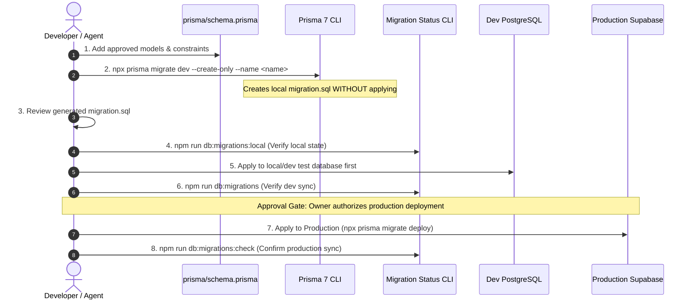

# YouTube Discovery — Professional Prisma 7 Migration Management Guide

**Document:** `docs/database/migration-management.md`  
**Version:** 1.0  
**Baseline Date:** 2 November 2026  
**Audience:** Maintainers, DevOps, and Coding Agents  

---

## 1. Overview & Purpose

The **Prisma 7 Migration Management CLI** is a custom, read-only diagnostic and monitoring toolkit engineered specifically for the YouTube Discovery platform.

It provides immediate, authoritative visibility into:
1. Local migration files in `prisma/migrations/`.
2. The remote database migration history in `public._prisma_migrations`.
3. Checksum integrity between local files and recorded database states.
4. History synchronization, pending migrations, failures, or divergence.

### Strict Read-Only Safety Guarantee

All inspection and monitoring commands in this CLI are **STRICTLY READ-ONLY**.
- **NEVER** executes `prisma migrate deploy`, `prisma migrate dev`, `prisma migrate reset`, or `prisma db push`.
- **NEVER** executes SQL mutations (`INSERT`, `UPDATE`, `DELETE`, `ALTER`, `DROP`, `TRUNCATE`, `CREATE`).
- **NEVER** modifies database rows or production data.
- **NEVER** exposes database passwords, connection strings, API tokens, or secrets.

---

## 2. CLI Commands Reference

The following commands are registered in `package.json`:

| Command | Mode | Description | Typical Use Case |
|---|---|---|---|
| `npm run db:migrations` | `full` | Complete formatted visual terminal dashboard comparing local files and database state | Routine developer monitoring and state assessment |
| `npm run db:migrations:local` | `local` | Inspects local migration files only without requiring any database connection or credentials | Offline development, local git diff inspection |
| `npm run db:migrations:check` | `check` | Validates migration synchronization with strict exit code reporting | CI/CD pipelines, pre-deployment preflight gates |
| `npm run db:migrations:json` | `json` | Outputs pure machine-readable JSON status | Automated tooling, scripts, dashboard integrations |
| `npm run test:migrations` | `test` | Executes the 43-assertion verification suite across all 8 scenarios | Regression testing and validation |

### CLI Flags & Options

You can pass options directly or through `node scripts/db-migrations/cli.mjs`:

```bash
# Verbose output (displays full SHA-256 hashes and failure logs)
node scripts/db-migrations/cli.mjs --verbose
node scripts/db-migrations/cli.mjs -v

# Custom migrations directory (for testing or isolated inspection)
node scripts/db-migrations/cli.mjs --migrations-dir=./custom/migrations

# Custom database connection URL (server-only)
node scripts/db-migrations/cli.mjs --connection-url="postgresql://..."

# Display help and usage
node scripts/db-migrations/cli.mjs --help
```

---

## 3. How Applied and Pending Migrations are Identified

The CLI compares the local filesystem with the database using the following rules:



1. **Local Discovery:**
   - Scans `prisma/migrations/` for valid directories.
   - Verifies existence of `migration.sql`.
   - Computes SHA-256 hash using both raw UTF-8 content and LF-normalized content (to avoid false positives on Windows Git CRLF checkouts).
2. **Database Discovery:**
   - Queries `public._prisma_migrations` using a read-only `SELECT`:
     ```sql
     SELECT id, checksum, finished_at, migration_name, logs, rolled_back_at, started_at, applied_steps_count
     FROM public._prisma_migrations
     ORDER BY started_at ASC, id ASC;
     ```
3. **Classification:**
   - **Applied (`✓ Applied`):** Exists on disk, exists in DB, `finished_at` is set, `rolled_back_at` is null, and local SHA-256 matches recorded DB checksum.
   - **Pending (`○ Pending`):** Exists locally in `prisma/migrations/` but has not been recorded in the database.
   - **Failed (`✗ Failed`):** Recorded in database with `finished_at IS NULL` or explicit error logs.
   - **Rolled Back (`↶ Rolled Back`):** Recorded in database with `rolled_back_at IS NOT NULL`.
   - **Checksum Mismatch (`≠ Mismatch`):** Recorded in database, but local file has different SHA-256 checksum (indicates local file was modified after application).
   - **Missing Local (`? Missing Local`):** Recorded in database as applied, but directory or `migration.sql` does not exist on disk.

---

## 4. Status Indicators & Color Conventions

| Indicator | Color | Meaning | Required Action |
|---|---|---|---|
| `✓ Applied` | Bright Green | Migration successfully executed and checksum verified | None. In sync. |
| `○ Pending` | Bright Yellow | Local migration created but not yet applied to database | Review SQL and deploy when authorized |
| `✗ Failed` | Bright Red | Migration failed during database execution | Review error logs; fix schema before retrying |
| `≠ Mismatch` | Bright Red | Local file does not match database checksum | Restore original `migration.sql` or create new migration |
| `? Missing Local` | Bright Red | Recorded in DB but missing from local filesystem | Restore missing migration directory from Git |
| `↶ Rolled Back` | Yellow | Migration was explicitly rolled back in database | Informational |
| `● Connected` | Bright Green | Database reachable over TLS/network | Ready for database operations |
| `● Unreachable` | Bright Red | Database connection timed out or network error | Verify network, credentials, or Supabase project status |
| `● Local Only` | Gray | Running in `--mode=local` | No database connection attempted |

---

## 5. Exit Codes & CI Integration

The CLI provides standardized exit codes for automation:

| Exit Code | Meaning | Condition |
|---|---|---|
| `0` | **Synchronized / Clean** | All known migrations are synchronized, or in local mode local files inspected cleanly. |
| `1` | **Pending / Failed / Divergent** | Pending migrations exist, failures exist in DB history, or checksum mismatches detected. |
| `2` | **Database Unavailable** | Connection timed out, network unreachable, or `DIRECT_URL`/`DATABASE_URL` unconfigured. |
| `3` | **Fatal Error** | Unexpected filesystem permission error, syntax error, or unhandled crash. |

### CI Workflow Example

```yaml
- name: Verify Database Migration Status
  run: npm run db:migrations:check
  env:
    DIRECT_URL: ${{ secrets.DIRECT_URL }}
```

---

## 6. How to Safely Create and Apply Future Migrations

Once the owner approves the Phase 1 canonical database design, migrations must proceed through this controlled workflow:



### Development vs Production Migrations

- **Development (`prisma migrate dev`):**
  - Creates new timestamped migration directories (`YYYYMMDDHHMMSS_name`).
  - Should always be run with `--create-only` first to allow human inspection of generated SQL before execution.
- **Production (`prisma migrate deploy`):**
  - Applies only committed, pre-existing local migrations from `prisma/migrations/`.
  - Never generates new migrations or modifies existing ones.
  - Safe, predictable, and suitable for deployment pipelines.

---

## 7. Troubleshooting Common Database States

### Case 1: `Table '_prisma_migrations' does not exist in the database`
- **Cause:** Database is brand new or migrations have never been initialized.
- **Status:** `TABLE_NOT_INITIALIZED` (Yellow warning).
- **Resolution:** No action needed until approved migrations are deployed. Once the first migration is applied, Prisma will automatically create `_prisma_migrations`.

### Case 2: `Database connection failed (ETIMEDOUT)`
- **Cause:** Network unreachable, firewall blocking port 5432/6543, or Supabase project is paused due to Free plan inactivity.
- **Status:** `DATABASE_UNAVAILABLE` (Red alert, exit code 2).
- **Resolution:** Check Supabase Dashboard to confirm project is active. Verify `DIRECT_URL` and `DATABASE_URL` in `.env.local`.

### Case 3: `Checksum Mismatch`
- **Cause:** Someone edited a `migration.sql` file after it was already applied to the database.
- **Status:** `DIVERGENT` (Red alert, exit code 1).
- **Resolution:** Revert `migration.sql` to the exact content matching the database checksum. If schema changes are needed, create a **new** additive migration instead of modifying past migrations!
